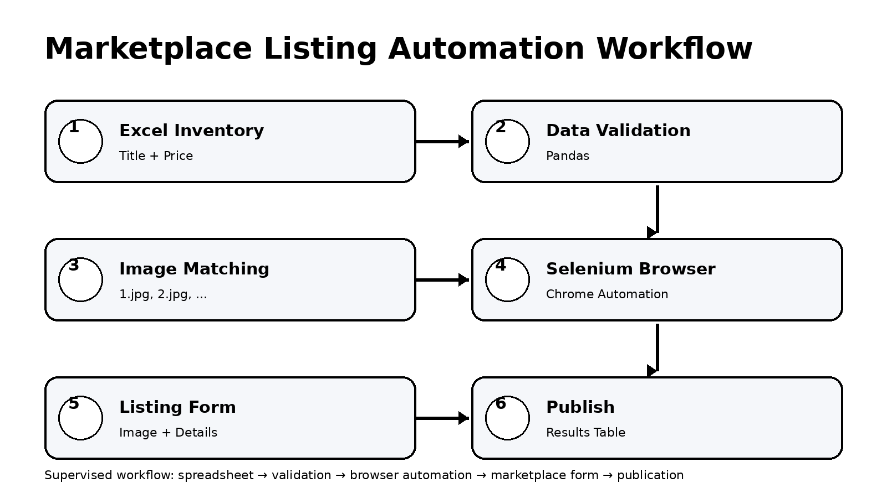

# Marketplace Listing Automation System

Python + Selenium automation workflow for creating Facebook Marketplace listings from spreadsheet inventory data.

## What it does

- Reads product titles and prices from Excel
- Matches product numbers to local images
- Starts Chrome using Selenium
- Uses supervised/manual Facebook authentication
- Uploads product images
- Enters title and price
- Selects category and condition
- Adds description and product tags
- Processes listings in a controlled batch
- Produces a success/failure results table

## Repository

```text
facebook-marketplace-automation/
│
├── Marketplace_Automation.ipynb
├── README.md
├── requirements.txt
└── workflow.png
```

## Input format

The notebook expects an Excel file called `items.xlsx` with:

| Title | price |
|---|---:|
| Sample Mattress | 250 |
| Sample Bed | 500 |

Images are matched by listing number, for example:

```text
1.jpg
2.jpg
3.jpg
```

## Installation

```bash
pip install -r requirements.txt
```

Then open:

```text
Marketplace_Automation.ipynb
```

and run the cells from top to bottom.

## Important security note

Do not commit Facebook passwords, private inventory, customer information, CAPTCHA images, or the local `chrome_profile` directory to GitHub.

Authentication is intentionally supervised in the notebook rather than storing account credentials in source code.

## Workflow



## Technologies

Python · Selenium · Pandas · OpenPyXL · Pillow · Matplotlib · WebDriver Manager

## Portfolio focus

This project demonstrates Python programming, data validation, spreadsheet-driven automation, browser automation, reusable function design, and exception handling.

## Future improvements

- Configuration-driven listings from Excel
- GUI for selecting inventory and images
- Execution analytics dashboard
- AI-assisted product descriptions
- Database-backed inventory
- Platform-specific automation adapters
